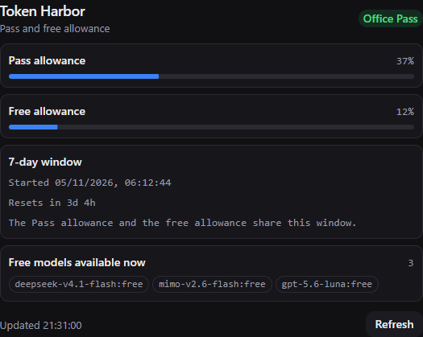

# OpenChamber Token Harbor Usage

See how much of your Token Harbor allowance is left, without leaving OpenChamber.



## What you get

- **The Pass you hold**, on the badge, and whether it is spent.
- **The Pass allowance**: the share of this 7-day window used.
- **The free allowance**: the share of the free-model allowance used, kept
  apart from the Pass because it is spent differently.
- **The 7-day window**: when it started, how long until it resets and restores
  both allowances, and that the two share it.
- **The `:free` models your key can call right now**, and whether free models
  are turned on for the account at all.
- **A compact line in OpenChamber's sidebar** with the same two meters, so the
  numbers are there while you work.

It reads when the panel opens, again every five minutes while it stays open, and
whenever you press **Refresh**.

The colours come from the app's theme, so the panel matches whatever OpenChamber
is set to. Run `npm run preview` to draw it in a browser without installing it;
add `?state=spent` or `?state=none` to see the spent and no-Pass states.

## Requirements

- OpenChamber **2.2.0 or newer**.
- A Token Harbor API key (`thk_live_…`).

## Install

1. In OpenChamber, open **Settings → Extensions**.
2. Paste this repository's URL and press **Add**.
3. Approve the network permission — the extension reads one Token Harbor
   endpoint and nothing else.
4. Paste your Token Harbor API key in **Settings → Integrations → Token Harbor**.
5. Open the **Token Harbor Usage** panel from the rail on the right.

## Where the key comes from

**Settings → Integrations → Token Harbor** is the only source. Paste the key
there once; OpenChamber stores it and adds the `Authorization: Bearer` header to
the extension's requests, so the key never passes through the extension itself.

There is no second place to look — no on-disk login file, no environment
variable. Token Harbor issues its key in the dashboard rather than through a CLI
that logs in on your machine, so there would be nothing for a fallback to read.
Without a stored key the panel says so and points at the Integrations card.

## How it works

```text
panel ──▶ OpenChamber host (adds the key) ──▶ tokenharbor.ai/api/cli/free-tier
```

One GET, with no parameters: the account is the one the key belongs to, so a key
can only ever read its own allowance. The call is read-only, free, and does not
count against your rate limit or use any allowance.

### What the numbers mean

Token Harbor reports **percentages, not money**: how much of the window is used,
never how many dollars are left. The Pass allowance and the free allowance are
measured separately but share one window, so a single reset applies to both.

Whether something is *spent* is taken from Token Harbor's own
`plan_exhausted` / `exhausted` flags rather than from a percentage hitting 100:
the two do not always happen on the same request.

Source of this contract: <https://tokenharbor.ai/docs/api/allowance>.

## Privacy

- The API key is stored by OpenChamber and attached by the host; the extension
  never reads it from disk and never sees an environment variable.
- The extension reaches exactly one origin, `https://tokenharbor.ai`, declared
  in the manifest and shown in the install approval dialog.
- A failed lookup becomes a short, fixed message chosen from the HTTP status —
  never the API's own error body.
- No usage data leaves your machine other than the allowance request itself.

## Verified

- Windows, OpenChamber 2.8.0, Token Harbor Pass

## Development

Saved TypeScript is bundled into the committed `panel/main.js` and
`status/status.js` — installing from a Git URL does not build.

```sh
npm install
npm test
npm run typecheck
npm run build
npm run preview   # the panel in a browser, at http://127.0.0.1:8791
```

- `panel/allowance.ts` holds every rule about the Token Harbor response:
  parsing, clamping, and the failure messages. No DOM, no Node, so it is the part
  under test in `test/allowance.test.ts`.
- `panel/app.ts` draws the panel. `createApp` takes the loader as an argument,
  so `test/app.test.ts` drives every state through happy-dom with no host, no
  network and no browser, down to the class names matching the stylesheet.
- `panel/main.ts` is the OpenChamber entrypoint: it connects the host, makes the
  one request, and hands the answer to `createApp`.
- `preview/` is a development-only harness; it is not part of the extension.

## Scope

- English only. The Command Code extension also ships `README.zh-CN.md` and
  `README.ja.md`; this one does not.
- No local service process, so there is no `serviceRequest` path and no extra
  permission to approve.
- The panel is a read-only view. Buying a Pass, topping up, or changing "Keep
  working after my Pass allowance runs out" stays in the Token Harbor dashboard.
